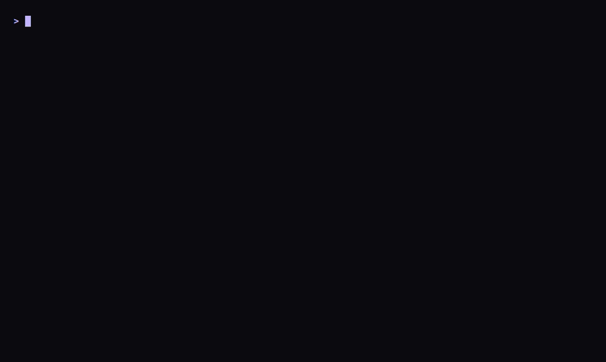
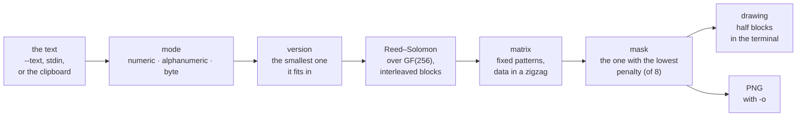

<p align="right"><sub><b>English</b> · <a href="README.md">Español</a></sub></p>

# clip2qr

<p>
  <a href="https://github.com/agustinyarrus/clip2qr/releases/latest"></a>
  
  
  
  <a href="LICENSE"></a>
</p>

What you copied, as a QR code in the terminal. clip2qr takes the clipboard (or a text) and draws it with half blocks, square and centered, so you can scan it with your phone's camera straight off the screen: a URL, a Wi-Fi password, an address, without sending yourself a message.

<p align="center">
  <picture>
    <source media="(prefers-reduced-motion: reduce)" srcset="demo/demo.png">
    
  </picture>
</p>
<p align="center"><sub>A real session in a 100×30 terminal, recorded with <a href="https://github.com/charmbracelet/vhs">VHS</a>; the QR in the GIF reads with a phone (and with zxing-cpp) · <a href="demo/demo.webm">as video</a> · <a href="demo/demo.tape">the script</a> · <a href="demo/LEEME.en.md">how to re-record it</a></sub></p>

<details>
<summary>No images? The same session, as text</summary>

```text
> clip2qr --text "https://github.com/agustinyarrus/clip2qr"

  clip2qr  ·  convierte el portapapeles en un QR                                            v1.0.0


                                 █████████████████████████████████
                                 ██ ▄▄▄▄▄ ██▀██ █▄▀ ▀▀▄ █ ▄▄▄▄▄ ██
                                 ██ █   █ █ █▀▄ ▀█▄█▀██ █ █   █ ██
                                 ██ █▄▄▄█ █ ▄▄ ▀▀▄▀▄██▄ █ █▄▄▄█ ██
                                 ██▄▄▄▄▄▄▄█ █▄█ █▄▀ █ ▀ █▄▄▄▄▄▄▄██
                                 ██ ▀▄   ▄███▄▀▀▄ █▀ ▀▀▀█   ▄▄█▀██
                                 ██▄▀ ▀ ▀▄ ▄  ▄██▀▄▄█▄█▄███▄▀█▀███
                                 ██▀▄   ▄▄▀▄▀   ▄ ▄▀ ▀▀▀▀▀▀▀▄▄█▀██
                                 ███ ▀▄ ▄▄██  █ ▄█▄ ▄▀▀  ▀▀ ▄▄▀███
                                 ██ ██ █ ▄  ▄ █ ▀███ █ █ ▀ ▀▄ █▀██
                                 ██ █▄▄▀ ▄▀██ ▄▀ ▄▄▄█▄█ ▀ ▄▄█▄▀███
                                 ██▄█▄█▄▄▄█  ▄▄ █▄▄ ▄▀▄ ▄▄▄ ▀   ██
                                 ██ ▄▄▄▄▄ █▀ ▄ ██▀  █▄  █▄█ ▄▄▀███
                                 ██ █   █ █ ▄  █▀▀▄ ▄█▀ ▄▄▄▄▀   ██
                                 ██ █▄▄▄█ █▄▀▀▀ █ ▄█▄ ▄  ▄ ▄ ▄ ███
                                 ██▄▄▄▄▄▄▄█▄▄█▄██▄▄▄▄█▄██▄▄▄█▄████
                                 ▀▀▀▀▀▀▀▀▀▀▀▀▀▀▀▀▀▀▀▀▀▀▀▀▀▀▀▀▀▀▀▀▀


     clip2qr

     ● Contenido    https://github.com/agustinyarrus/clip2qr
     ● Longitud     40 caracteres
     ● Fuente       argumento --text
     ● Versión QR   3 (29×29)
     ● Corrección   nivel M
```

</details>

A single `.exe` of about 2 MB, in pure Go and with its own QR encoder: no installer, no dependencies, no cloud; the text never leaves the machine. It used to live in navaja, a suite of console tools for Windows; now it's a project of its own.

[Why](#why) · [Install](#install) · [Usage](#usage) · [Walkthrough](#walkthrough) · [How it works](#how-it-works) · [How it was verified](#how-it-was-verified) · [Limits](#limits)

## Why

Getting a URL from the PC to the phone usually ends in a message to yourself, in a chat or an email: the text travels to a server to cross one meter. A QR on the screen solves it with no network, and in the terminal there's nothing to open: `clip2qr` and the camera.

Drawing it well takes some technique:

- **Square and readable.** A console character is twice as tall as it is wide. With half blocks (`▀ ▄ █`), each character carries two stacked modules: the code comes out square and takes half the lines.
- **Inverted on a dark console.** Readers expect dark ink on light paper. On a terminal with a black background, clip2qr paints the *light* module and leaves the dark one in the background color; `-i` is for light-background terminals.
- **A QR that only its own encoder can read is useless.** A mistake in the order of the Reed–Solomon polynomial gives a code that looks perfect and that no phone can read (it happened to clip2qr at the beginning). That's why every code is checked against zxing-cpp, an independent decoder, both in the PNG and in the terminal drawing.

## Install

Download `clip2qr.exe` from the [latest release](https://github.com/agustinyarrus/clip2qr/releases/latest) and copy it to a folder on your `PATH`. It's the whole program: 64-bit Windows 10 or 11 (it was tested on Windows 11), no installer. Next to it comes `SHA256SUMS` to check it:

```powershell
(Get-FileHash .\clip2qr.exe -Algorithm SHA256).Hash -eq ((Get-Content .\SHA256SUMS) -split '\s+')[0]   # True
```

The `.exe` is reproducible: the same tag built with the same Go gives the same bytes on any machine ([how](docs/RELEASE.en.md#5-the-exe-is-reproducible)).

With [Go](https://go.dev/dl) 1.26 or newer (with an older Go 1.21+, Go downloads the version the `go.mod` asks for on its own):

```powershell
go install github.com/agustinyarrus/clip2qr@latest
```

From the repo:

```powershell
.\build.ps1          # dist\clip2qr.exe, with the version, the commit and the SHA256
.\build.ps1 -Test    # before that, go vet and all the tests
```

It has no external modules: the encoder, the PNG and the clipboard are Go's standard library and our own code.

## Usage

```powershell
clip2qr                                  # QR of whatever is on the clipboard
clip2qr "https://ejemplo.com/pagina"     # of a specific text (or with --text)
Get-Content nota.txt | clip2qr -         # from standard input (or with --stdin)
clip2qr -e h -o wifi.png                 # high correction and, also, saved as a PNG
clip2qr -i                               # for light-background terminals
```

| Flag | What it does |
|---|---|
| `--text TEXT` | use this text instead of the clipboard |
| `--stdin`, `-` | read the text from standard input |
| `-e`, `--level l\|m\|q\|h` | the error correction: higher, more robust and denser (m) |
| `-q`, `--quiet N` | light border modules around it (2); the PNG gets at least 4 |
| `-i`, `--invert` | swap light and dark, for light-background terminals |
| `-o`, `--png FILE` | also save the QR as a PNG |
| `-s`, `--scale N` | pixels per module in the PNG (8) |

GNU-style flags (`-e h`, `--level=h`, `--`); a misspelled flag suggests the closest one. It honors `NO_COLOR` and `--no-color`; if the output isn't a console, it doesn't emit a single escape code (and the drawing stays the same, as text). Exit codes: `0` all good · `2` invalid command line · `3` it couldn't be done (the clipboard has no text, or the text doesn't fit even in version 40).

<details>
<summary><code>clip2qr --help</code>, in full</summary>

```text
> clip2qr --help

  clip2qr  ·  convierte el portapapeles en un QR en la terminal                             v1.0.0

  uso
    clip2qr                  QR de lo que haya en el portapapeles
    clip2qr "texto o URL"    QR de un texto puntual
    echo hola | clip2qr -    QR de la entrada estándar

  contenido
        --text TEXTO      usar este texto en vez del portapapeles
        --stdin           leer el texto de la entrada estándar

  código
    -e, --level l|m|q|h   corrección de errores (más alto = más robusto y más denso) (m)
    -q, --quiet N         módulos de borde claro alrededor (2)
    -i, --invert          invertir claro/oscuro (para terminales de fondo claro)

  guardar
    -o, --png ARCHIVO     además, guardar el QR como PNG
    -s, --scale N         píxeles por módulo en el PNG (8)

  general
    -h, --help            muestra esta ayuda
    -V, --version         muestra la versión
        --no-color        salida sin colores (también respeta NO_COLOR)

  ejemplos
    clip2qr                      el caso típico: copiás una URL y la escaneás con el teléfono
    clip2qr -e h -o wifi.png     QR robusto y guardado como imagen
    clip2qr --text "https://…"   sin tocar el portapapeles

  notas
    · Todo local: el texto no sale de la máquina.
    · El QR se dibuja con medios bloques para que quede cuadrado; si tu terminal no los muestra
      bien, guardá el PNG.
```

</details>

## Walkthrough

Every output in this section is real: clip2qr 1.0.0 in a 100-column console, captured on Sep 28, 2026 (the tool speaks Spanish). In the console, the code is painted on the dark background; here, depending on the browser's font, you may see thin lines between rows that aren't there in the terminal.

### A Wi-Fi network, robust and as a PNG

The `WIFI:S:<network>;T:WPA;P:<password>;;` format is the one Android and iPhone cameras understand to connect without typing the password. With `-e h` the code survives up to 30 % of it being covered (on a screen with glare, that helps), and with `-o` it's also kept as an image, with the 4-module border the standard asks for. The PNG from this run, 360×360, is read by zxing-cpp with the exact text.

```text
> clip2qr --text "WIFI:S:MiRed;T:WPA;P:clave-secreta-123;;" -e h -o wifi.png

  clip2qr  ·  convierte el portapapeles en un QR                                            v1.0.0


                             █████████████████████████████████████████
                             ██ ▄▄▄▄▄ █    ▄██ ▄▀██▀ ▀▀██ ▀▀█ ▄▄▄▄▄ ██
                             ██ █   █ █▄▀ ▄██▄▄█▄▀ ▄▀▄ ▄▀  ██ █   █ ██
                             ██ █▄▄▄█ █▀▀ █ ▀ ▄█▄▀▀▀▄ ▀█ ▀ ▄█ █▄▄▄█ ██
                             ██▄▄▄▄▄▄▄█ █ █▄█▄▀ ▀▄█ ▀ ▀▄▀▄█▄█▄▄▄▄▄▄▄██
                             ████  ▄█▄▀▄▄ ▀▄▀ ▄██▀▄█▀▀▀ ▀▄▀█ ▄▄█▀▄▄▄██
                             ██ ▄▄██▀▄▀▀▄ ▀▀ ▀██ ▄ █▀█▀▄█ ▄▄▀▀█▄▀█ ▄██
                             ██▄ ▄▀ █▄▀█ ▀▀██▄ ▄▄ █▄▀▀██ ▄█▀▀▄▀▄▄▄█▄██
                             ██ ▄ ▄▄▀▄▀▄ ▀▀▀▄ ▄▄▀ ▄▄ ███▄▀▄▄██▀▄█▄  ██
                             ██ █▀ ▄▀▄▄▄▀▀  ███ ▄▀█ █▀ ▀█  ▀  ▄▄▄█  ██
                             ██ ▀ ▄ ▀▄███▀  █▄▄▄▄▀▀█▄ ▀ ▄▀ █  ▀█ █▄ ██
                             ██▄▀▄▀▄▄▄ █▄██▄▀██▄█  ▀█▀▀ ▄ ▄▄█▄▀██ ████
                             ██▄█▀ ▄▀▄▄█▄▀▀▄▄▀ ▄█       █▀▄▄▀▄▀▄▄█▄ ██
                             ██  █▀ ▀▄▀▄▄▄▀▀ ▀▀███ ▄█ ▄▀▀▀▄▄▀▄▄▄▄ ▄▄██
                             ██ █▄█▄ ▄█   ▀ ▄█ █▀█▀█▀ █▀█▀▄▄██▄█▀█▄▄██
                             ██▄█▄█▄▄▄█▀ ▄▀▄▀▀▀██ █▀▄▀▀██ █ ▄▄▄ ▀ ████
                             ██ ▄▄▄▄▄ ████▀▀█▄▀▀ ▀ ████████ █▄█ ██▄▄██
                             ██ █   █ █ ▀▄▀ ▄▀█▄ ▀▀▄  █▄▄▀▄▄     ▀█▄██
                             ██ █▄▄▄█ █▄▄▀█▀███▀▀█▄▀ █ ▄▄██▄   ██▄█ ██
                             ██▄▄▄▄▄▄▄██▄██▄▄▄██▄▄▄██▄▄▄▄▄██▄█████▄▄██
                             ▀▀▀▀▀▀▀▀▀▀▀▀▀▀▀▀▀▀▀▀▀▀▀▀▀▀▀▀▀▀▀▀▀▀▀▀▀▀▀▀▀


     clip2qr

     ● Contenido    WIFI:S:MiRed;T:WPA;P:clave-secreta-123;;
     ● Longitud     40 caracteres
     ● Fuente       argumento --text
     ● Versión QR   5 (37×37)
     ● Corrección   nivel H
     ● PNG          wifi.png
```

### What doesn't fit

Version 40, the biggest one, has 177×177 modules. Whatever doesn't fit even there is an error with the numbers, not a broken code:

```text
> clip2qr --text ('a' * 3000)

  ✗ el texto es demasiado largo para un código QR (3000 caracteres, nivel M)
```

### A misspelled flag

```text
> clip2qr --text hola --levle h

  ✗ no conozco --levle; ¿quisiste decir --level?
  › clip2qr --help muestra todas las opciones
```

## How it works



### Where the text comes from

In this order: `--text`, standard input (`--stdin` or `-`), the loose arguments joined with spaces and, if there's none of that, the clipboard. The clipboard is read through the Windows API as `CF_UNICODETEXT` (UTF-16) and converted to UTF-8; opening it is retried for a few moments, because another program may be holding it, and the memory is copied to a Go buffer capped at 16 million characters. An empty or whitespace-only text is an error, not an empty QR.

### The data

- **The most compact mode** that covers the whole text: numeric (3 digits in 10 bits), alphanumeric (2 characters from a set of 45 in 11 bits) or byte (UTF-8 as is). Lowercase letters aren't in the alphanumeric set: a lowercase URL goes in byte mode.
- **The smallest version** that fits the mode indicator, the character count (whose length depends on the mode and on the version band, 1–9, 10–26 and 27–40) and the data, at the requested level.
- **The standard's padding**: terminator, byte alignment and the alternating `0xEC 0x11` bytes up to capacity.
- **The tables**, as little by hand as possible: total codewords per version, correction per block and number of blocks. The split into two groups of blocks is derived with the standard's rule instead of tabulating the 160 combinations.

### The error correction

- **GF(256)** with the polynomial `x⁸+x⁴+x³+x²+1` (`0x11d`) and exponent and logarithm tables: multiplying is two lookups.
- **Reed–Solomon**: the generator polynomial of each degree is computed once, with the leading coefficient first. That order was the bug that at first made every code unreadable; `TestReedSolomonVector` pins the bytes of a known vector so it doesn't come back.
- **Interleaving**: codewords are taken column by column across the blocks. A smudge or a glare damages bytes from several blocks, and each one corrects it on its own.

### The matrix and the mask

- The fixed patterns: the three finders with their separators, the alignment ones (from version 2), the timing lines and the dark module. The format (level and mask) goes with BCH(15,5) in its two copies, and the version, with BCH(18,6) from version 7.
- The data, in a zigzag two columns at a time, up and down, dodging column 6 and what's reserved.
- **The mask**: all 8 are tried and the one with the lowest penalty is kept according to the standard's four rules (runs of 5 or more equal modules, 2×2 blocks, patterns that look like a finder and the imbalance between light and dark). It costs O(8·n²), with n the side.

### The drawing

- **In the terminal**, two rows of modules per line: `▀` (top), `▄` (bottom), `█` (both) or a space, with the `--quiet` border (2 by default, to save room) and centered in the window's width. Inverted by default, for dark consoles.
- **As a PNG**, `--scale` pixels per module and at least 4 border modules, the standard's minimum, written atomically (temporary file and rename: a crash doesn't leave a half-written image).

More detail: [docs/ARQUITECTURA.en.md](docs/ARQUITECTURA.en.md).

## How it was verified

The rule: clip2qr isn't checked against itself. [zxing-cpp](https://github.com/zxing-cpp/zxing-cpp), an independent and widely used decoder, reads what clip2qr writes.

| What | Against what | Result |
|---|---|---|
| the encoder | [`gen.go`](internal/qr/_oracle/gen.go) emits 72 PNGs (15 texts by 4 levels: digits, alphanumeric, Spanish with accents and ñ, Hebrew with Japanese, Wi-Fi, vCard; and the 12 longest texts that fit in version 40, one per mode and level) and [`decode.py`](internal/qr/_oracle/decode.py) reads them with zxing-cpp | 72 of 72, from version 1 to 40 |
| the terminal drawing | [`terminal_all.ps1`](internal/qr/_oracle/terminal_all.ps1): 5 texts (from "hola" to 300 letters), each one normal, inverted and at level H; [`terminal_check.py`](internal/qr/_oracle/terminal_check.py) rebuilds the matrix from the half blocks the `.exe` prints and decodes it | 15 of 15, and the control with a different expected text fails, as it should |
| the demo | the last frame of this README's GIF, with zxing-cpp | the exact URL |

- **58 Go tests** (`go test ./...`), among them the Reed–Solomon vector and the standard's version 40 capacity limits (ISO/IEC 18004, table 7), per mode and level: the longest text that fits gives version 40 and one more gives an error.
- **CI on `windows-latest`** with the minimum Go from the `go.mod` ([`ci.yml`](.github/workflows/ci.yml)): formatting, `go vet` (for Linux too), all the tests, the `.exe` with its version and its SHA256, and the two zxing-cpp oracles on that `.exe`.

The details, with the lesson of the backwards polynomial: [docs/VERIFICACION.en.md](docs/VERIFICACION.en.md).

## Limits

- **Reading the clipboard has no automated test.** Neither the tests nor the oracles touch the clipboard of whoever runs them (that would overwrite what they have copied): they pass the text with `--text`.
- **A single mode per code.** A URL with a long number at the end goes entirely in byte mode; splitting it into segments of different modes would give a code one or two versions smaller.
- **No ECI**: byte mode doesn't declare that the text is UTF-8, and readers guess it (zxing-cpp gets it right in every oracle case, Hebrew and Japanese included).
- It's built and tested for `windows/amd64`. The encoder builds on any system (the CI runs `go vet` for Linux), but clip2qr reads the Windows clipboard.

What's missing, in order: [docs/PENDIENTE.en.md](docs/PENDIENTE.en.md).

## Structure

```
main.go               opens the console and calls clip2qr.Main
internal/
  clip2qr/            the tool: where the text comes from, the centered drawing, the PNG and the card
  qr/                 the encoder: modes, tables, GF(256), Reed–Solomon, BCH, masks, drawing
    _oracle/          gen.go, decode.py, terminal_check.py and terminal_all.ps1, against zxing-cpp
  win/desk/           the clipboard and the console mode, through syscall
  fsx/                atomic writing of the PNG
  cli/                GNU-style flags, help, "did you mean…?"
  tui/                console: palette, cards, es-AR formatting
  textdist/           Damerau–Levenshtein distance
  version/            version and commit, stamped by build.ps1
demo/                 the README's recording and its VHS script
docs/                 architecture, verification, to-dos and how a release is put together
.github/              the CI: formatting, vet, tests, oracles and the .exe with its SHA256
build.ps1             builds dist\clip2qr.exe with the version and the commit (-Test: vet and tests first)
```

## License

[MIT](LICENSE).

<!-- i18n source=README.md sha256=39edba3c612a -->
